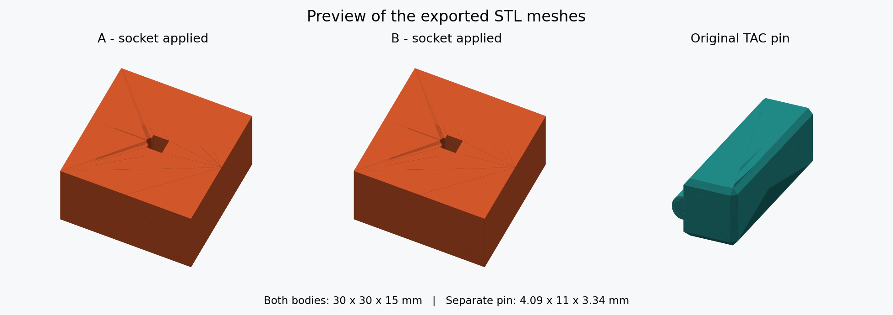

# TAC Joint

TAC Joint adds a built-in cut connector based on a matching pair of contributed
STL meshes. The original files live in `resources/cut_connectors/tac_joint/`;
the application embeds the meshes and needs no external files at runtime.

## Usage

1. Select an object and open the Cut tool (`C`).
2. Choose a cut (Flat, Curved or Draw surface) and open Add connectors / Edit connectors.
3. Select **TAC Joint** and place it on the cut face.
4. Adjust the parameters, confirm the connectors, and perform the cut.

Choose **Placement** for each connector:

- **On build plate** (default): matching sockets in both halves and a separate
  connector laid flat beside the parts, retaining its assembled pose.
- **Attached to A / Attached to B**: the original connector becomes a positive
  part of that half, with no socket there. Only the opposite half gets a socket.
  Discarding the selected half also discards its attached connector.

Enable **Apply TAC joints to mesh** to subtract all TAC sockets directly from
the body meshes during the cut and unite attached connectors with their owning
parts. This per-cut checkbox is initially off and applies to every TAC connector
in that cut. Separate connectors remain printable objects on the build plate.
Other negative volumes and modifiers stay editable, and the original body parts
retain their settings. **Cut to parts** keeps its two bodies as separate parts.
If applying a joint fails, the cut is refused and the source object is preserved.

Rendered from the exported STL meshes: both 15 mm halves of a 30 mm cube contain
their sockets, and the separate pin retains its reference profile.

For a model that is already cut, close the Cut tool, right-click either half and
choose **Edit cut...**. Enable **Apply TAC joints to mesh** there and perform the
cut again. This rebuilds both original halves from the saved uncut shape.
Opening `C` on a half instead makes a new cut through only that selected object;
the other original half and its separate connector remain in the project.

The blue preview represents the matching cutter. With the checkbox off, use the object's
**Mesh Boolean** action on each half to bake its sockets into the body and merge
any attached connectors. The resulting mesh can be exported as STL with its
cutouts. A and B refer to the labelled cut halves, regardless of print placement.
Clearances apply only to sockets; an attached connector keeps its original size.
Sockets generated by an older build must be re-created with the corrected cut
tool before applying Mesh Boolean.

| Parameter | Default | Meaning |
|---|---:|---|
| Placement | On build plate | Separate connector, or attached to A/B |
| Size | 100% | Original connector: approximately 4.09 × 3.34 × 11 mm |
| Side clearance | 0.12 mm | Nominal clearance per side |
| End clearance | 0.30 mm | Clearance at each end |
| Cut offset | 0 mm | Midpoint cut; 5.5 mm engagement per half without kerf |
| Rotation | 0° | Rotation in the cut plane, adjustable through 360° |

**Reset TAC Joint** restores these defaults. When editing multiple connectors,
only the edited field changes; reset replaces all parameters.

Default values preserve the original STL geometry. Side clearance is a nominal
dimension adjustment, not a constant surface-normal offset around rounded
profiles. Scaling preserves the configured clearances in millimetres.
Geometric validation rejects interference and insufficient engagement.

## Supported cuts and persistence

Flat cuts support kerf, which reduces engagement without lengthening the pin.
With separate connectors both halves may be kept as parts of one object.
Attached connectors require separate A/B objects, since a negative volume acts
on all positive parts of its object. Parameters, placement and rotation survive
project save/load, cut recipes, copying, and undo. The mesh application checkbox
is also remembered by editable cuts and undo. Older TAC projects default to
separate connectors with mesh application off. Recipe version 9 prevents older
builds from silently re-cutting an applied result with different behavior.

Curved and drawn cuts use the full socket on the local surface frame. Groove
cuts, mixing with Flexi joints, individual part assignment, and mirroring are
explicitly blocked for TAC Joint. The body boundary check samples the socket
mesh, so narrow internal voids between
samples can be missed. Connector/socket fit uses separate geometric validation.

## Development and validation

Geometry and validation are in `src/libslic3r/TacJoint.cpp`; cut integration is
in `CutUtils.cpp`, and UI controls are in `GLGizmoCut.cpp`. Manual Mesh Boolean
and STL export share `TacJointBoolean.hpp` for objects containing TAC volumes.
It uses Manifold for the union and subtraction, then welds only identical
float coordinates and removes collapsed faces. The normal input validation
still runs; objects without TAC volumes retain their existing Boolean paths.

Run `python scripts/generate_tac_joint.py --check` to verify reproducible
embedded mesh data. The generator uses only the Python standard library.
Follow the platform build instructions in the repository README. With
`BUILD_TESTS` enabled, build the `libslic3r_tests` target and run it with the
Catch2 filters `[TACJoint],[TACAttachment]`. Related regression filters are
`[PushFit]`, `[CutRecipe]`, `[CutMirror]`, `[CurvedCut]`, `[DrawCut]`,
`[CutConnectorSurface]`, and `[CutConnectors]`.

Physical printing and network printing are not covered by these software tests.
